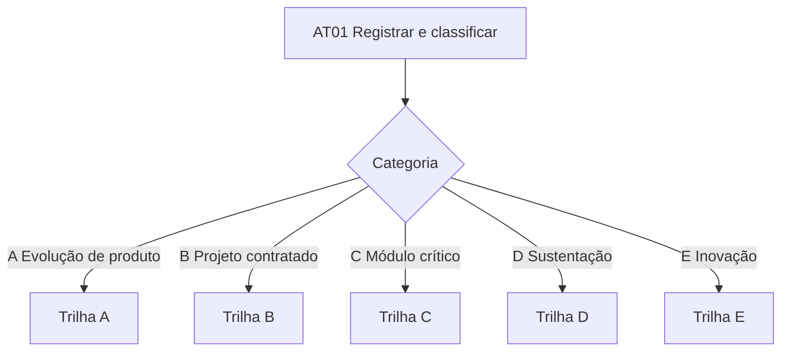

# Como Usar o Processo

Roteiro para quem chega com uma demanda. Comece pelo passo 1 e siga a trilha da categoria atribuída.

## 1. Registre e classifique

Toda demanda começa na [AT01 Registrar e classificar a demanda](./Atividades/Entrada-da-Demanda.md#at01-registrar-e-classificar-a-demanda). Preencha o [CL01 Enquadramento](./Checklists.md#cl01-enquadramento-da-demanda) e a categoria define a trilha.

## 2. Siga a trilha da categoria

### Trilha A, evolução de produto SaaS

Exemplo: agenda com confirmação automática por mensagem no Vértice Care.

| Etapa | Atividades | Artefatos obrigatórios | Checklist |
| --- | --- | --- | --- |
| Construção | AT12, AT13, AT14, AT15, AT16, AT17 | A03, A10, A17 | CL02, CL03, CL08, CL09 |
| Release | AT10, AT18 | A12 | CL06 |
| Implantação | AT20 | | |

### Trilha B, projeto contratado

Exemplo: integração do Autoriza com o sistema de uma operadora.

| Etapa | Atividades | Artefatos obrigatórios | Checklist |
| --- | --- | --- | --- |
| Concepção | AT02, AT03, AT04, AT05 | A01, A02, A15 | CL04 |
| Elaboração | AT06, AT07, AT08, AT09, AT10, AT11 | A03, A04, A05, A06, A07, A09, A12 | CL05 |
| Construção | AT12 a AT18 | A10, A17 | CL02, CL03, CL06, CL08, CL09 |
| Transição | AT19, AT20, AT21 | A13, A14 | CL07 |
| Durante todo o projeto | AT24 | A15, A16 | |

### Trilha C, módulo crítico ou regulatório

Exemplo: nova versão do faturamento TISS. Mesma trilha da B, com estes reforços.

| Reforço | Onde |
| --- | --- |
| Modelagem de ameaças e relatório A08 | AT08 |
| Nível ASVS 2 com verificação manual por iteração | AT16, CL09 |
| Teste de intrusão antes do go-live, relatório A11 | AT19 |
| Parecer do encarregado de dados | AT08 |

### Trilha D, sustentação

Exemplo: correção de cálculo de coparticipação.

| Etapa | Atividades | Artefatos obrigatórios | Checklist |
| --- | --- | --- | --- |
| Atendimento | AT22 | A03 | |
| Correção | AT13, AT14, AT15, AT16 | A10 | CL03, CL08 |
| Release | AT10, AT18, AT20 | A12 | CL06 |
| Incidente crítico | AT23 | | |

Limite de seis itens em progresso por squad e reserva de 20% da capacidade. Se a correção passar de 40 horas, volte à AT01.

### Trilha E, inovação

Exemplo: classificação automática de glosas por aprendizado de máquina.

| Etapa | Atividades | Artefatos obrigatórios |
| --- | --- | --- |
| Experimento de até quatro semanas | AT28 | A18 |

Se a hipótese for confirmada, a proposta volta à AT01 como nova demanda.

## 3. Quando algo foge da trilha

| Situação | O que fazer |
| --- | --- |
| O cliente pediu uma mudança de escopo | [AT24 Avaliar solicitação de mudança](./Atividades/Transversais.md#at24-avaliar-solicitação-de-mudança) |
| Um elemento obrigatório não faz sentido no seu projeto | [AT25 Aprovar desvio](./Atividades/Transversais.md#at25-aprovar-desvio-de-elemento-obrigatório) com o [CL10](./Checklists.md#cl10-solicitação-de-desvio) |
| Aconteceu um incidente crítico em produção | [AT23 Analisar causa raiz](./Atividades/Operacao.md#at23-analisar-causa-raiz-de-incidente-crítico) |
| A retrospectiva identificou um problema no processo | Registre no A17 e encaminhe ao engenheiro de processo para a [AT27](./Atividades/Transversais.md#at27-revisar-e-evoluir-o-processo) |
| Não sei qual categoria usar | Registre a dúvida no work item e acione o engenheiro de processo |
