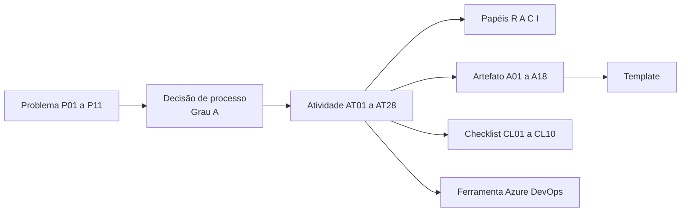

# Especificação do Processo

As seções 01 a 03 registram o Grau A: o diagnóstico da Vértice Sistemas e a proposta consolidada do Processo Vértice de Desenvolvimento. Esta seção registra o Grau B, em que a proposta vira um processo detalhado, operacional e utilizável por quem trabalha na organização.

:::info Versão 0.4, intermediária
Esta é a versão apresentada no T3, ao fim da Sprint 4. Atividades, papéis, templates e checklists estão especificados. Gerência de configuração, garantia da qualidade, governança, plano de medição e validação estão previstos para as Sprints 5 e 6, que concluem a Release 1.0. O plano está em [Evolução e Roadmap](./Evolucao-e-Roadmap.md).
:::

## O que esta seção contém

| Página | Conteúdo | Para quem |
| --- | --- | --- |
| [Como usar o processo](./Guia-de-Uso.md) | Roteiro por categoria, do registro da demanda à operação | Quem chega com uma demanda nova |
| [Rastreabilidade Grau A e B](./Rastreabilidade.md) | Como cada elemento da proposta virou especificação, e quais atividades tratam cada problema | Avaliação de consistência |
| [Atividades](./Atividades/index.md) | 28 atividades com propósito, entradas, saídas, papéis, ferramentas, critério de conclusão e passos | Quem executa |
| [Papéis](./Papeis.md) | 11 papéis com responsabilidades, autoridade, competências e artefatos | Quem assume um papel |
| [Templates](./Templates.md) | 18 modelos, um por artefato, com pacote para download | Quem produz artefatos |
| [Checklists](./Checklists.md) | 10 instrumentos de decisão, do enquadramento aos gates | Quem decide |
| [Evolução e Roadmap](./Evolucao-e-Roadmap.md) | Decisões do Grau B, dificuldades, pendências e plano até a Release 1.0 | Equipe e avaliação |

## Números da especificação

| Elemento | Grau A | Versão 0.4 |
| --- | --- | --- |
| Atividades | 25 linhas na Matriz RACI | 28 atividades especificadas, com 10 campos e passos cada |
| Papéis | 11 papéis com uma linha de propósito | 11 papéis especificados e 5 funções esclarecidas |
| Artefatos | 17 no catálogo | 18 no catálogo |
| Templates | 10 | 18, com cabeçalho comum e download |
| Checklists | Critérios em texto nas páginas de fases | 10 checklists marcáveis |
| Verificação de consistência | Manual | Automática no pipeline de publicação |

## Como as peças se ligam

Toda atividade declara os problemas que atende, os artefatos que produz e o instrumento que a apoia. Essas ligações são conferidas automaticamente a cada publicação do portal pelo script `scripts/verificar-consistencia.py`, que bloqueia a publicação se encontrar atividade sem responsável único, artefato sem template ou sem atividade que o produza, ou problema sem atividade que o trate.
